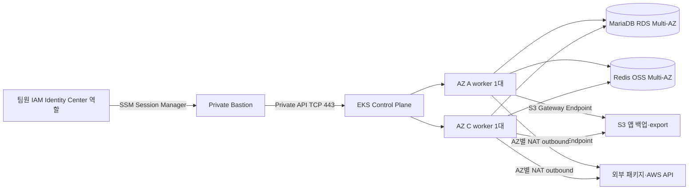

# SAI AWS 인프라 (Terraform)

서울 리전(`ap-northeast-2`)에 프로젝트 인프라의 기본 구성을 코드로 정의합니다. Mock Bank는 별도 VPC 모듈로 구현하지만 기본 Terraform root에서 호출하지 않습니다.

## 아키텍처와 통신 흐름



- `10.250.0.0/16` 안에 Public `10.250.1.0/24`, `10.250.11.0/24`, App Private `10.250.2.0/24`, `10.250.12.0/24`, Data Private `10.250.3.0/24`, `10.250.13.0/24`를 둡니다. 순서는 `availability_zones`와 대응합니다. `vpc_cidr` 또는 CIDR 대역을 바꿀 때에는 `subnet_cidrs`의 6개 값도 VPC 안에서 겹치지 않게 함께 변경하세요.
- Public subnet도 인스턴스 자동 공인 IP 할당은 끕니다. Internet Gateway 기본 경로가 있다는 이유만으로 그 안의 인스턴스가 공인 IP를 받아야 하는 것은 아닙니다. NAT Gateway는 각자 별도 Elastic IP를 사용합니다.
- App Private 서브넷은 같은 AZ의 NAT Gateway로 나가고, Data Private 서브넷에는 인터넷 기본 경로가 없습니다. S3 Gateway Endpoint를 App/Data 라우팅 테이블에 연결해 S3 요청이 NAT를 통과하지 않게 합니다.
- EKS API는 Private 전용입니다. Bastion은 App Private 첫 번째 AZ에 있으며 인바운드 SSH와 공인 IP가 없습니다. 팀원은 로컬 AWS SSO 자격 증명을 사용하고 Terraform이 만든 고정 SSM 문서로 EKS API의 TCP 443만 로컬 포트로 전달합니다. IAM 권한은 임의 host/port를 받는 AWS 관리형 원격 포워딩 문서를 허용하지 않습니다. Bastion의 outbound는 NAT를 통해 SSM 서비스에 연결됩니다. 이렇게 하면 Bastion의 공유 인스턴스 역할에 EKS 관리자 권한을 줄 필요가 없습니다.
- 각 AZ 서브넷만 사용하는 managed node group을 하나씩 만들고, 각각 desired/min/max를 1로 둡니다. 초기 배치가 AZ별 한 대가 되도록 고정했지만, 한 노드 또는 AZ 장애 때 서비스 무중단을 보장하지는 않습니다.
- EKS Control Plane audit/API 등 로그, Kubernetes Secret KMS 암호화, RDS storage 암호화, Redis 저장/전송 암호화를 설정합니다. DB/Redis 보안 그룹은 EKS node 보안 그룹만 허용하지만, 해당 노드에 올라간 모든 Pod가 연결을 시도할 수 있다는 뜻입니다. VPC CNI NetworkPolicy 엔진을 활성화하며, 앱 Namespace의 default-deny 및 DB/Redis 허용 정책은 Kubernetes 팀이 별도 YAML로 작성해야 합니다. 정책이 적용되기 전에는 Pod별 격리가 되지 않습니다.
- AWS Load Balancer Controller는 Terraform에서 설치하지 않습니다. Terraform은 Pod Identity Agent EKS add-on, 앱 및 Controller IAM 역할, 그리고 각 `namespace/ServiceAccount` Pod Identity association을 관리합니다. Kubernetes 팀은 앱 `sai/sai-api` ServiceAccount와 Controller `kube-system/aws-load-balancer-controller` ServiceAccount/Helm 설정을 같은 이름으로 맞추고 Controller·Ingress·Service·Deployment·Argo CD를 관리합니다. ServiceAccount에 IAM role annotation은 넣지 않습니다.
- Private subnet의 노드가 Pod Identity Agent를 통해 자격 증명을 받도록 `eks-auth` Interface VPC Endpoint를 만듭니다. Endpoint는 AZ별 시간·데이터 처리 요금이 추가되므로 예상 비용을 확인하세요.

## 파일·모듈 역할

| 파일/폴더 | 무엇을 만들거나 설명하나 | 왜 필요한가 / 팀원이 채우거나 확인할 값 |
| --- | --- | --- |
| `versions.tf` | Terraform·AWS/random/TLS provider 제약과 서울 리전 provider | Terraform 1.6 이상, AWS provider 5.x 기준으로 검토합니다. |
| `variables.tf`, `locals.tf` | 리전, AZ, 서브넷 CIDR, 인스턴스 크기, 보존 기간, 이름·태그 | AZ와 VPC·서브넷 CIDR이 서로 겹치지 않는지, EKS 버전과 비용·용량을 검토합니다. VPC CIDR을 바꾸면 `subnet_cidrs`도 함께 변경합니다. |
| `main.tf`, `outputs.tf` | 모듈 연결과 팀 간 output 이름 | 모듈 입출력 규격을 고정합니다. 출력은 AWS 생성 후에야 실제 값이 생깁니다. |
| `terraform.tfvars.example` | 민감 값 없는 설정 예시 | 실제 팀 IAM Role ARN과 접근 범위는 팀이 채웁니다. 이 파일은 바로 apply할 실계정 설정이 아닙니다. |
| `modules/network` | VPC, 6개 서브넷, IGW, AZ별 NAT, route table, S3 Gateway Endpoint | EKS/DB의 네트워크 경계를 제공하고 S3 트래픽의 NAT 경유를 줄입니다. CIDR은 사내·VPN 네트워크와 겹치지 않는지 확인합니다. |
| `modules/eks` | Private EKS, KMS 암호화, 관리형 애드온(Pod Identity Agent와 VPC CNI NetworkPolicy 포함), EKS Auth PrivateLink endpoint, CNI 전용 Pod Identity, AZ별 node group, Bastion, 제한된 SSM 문서·로그 | 팀 운영자 역할을 EKS Access Entry에 연결합니다. AWS 계정 외부에서 만든 운영자 Role ARN, 접근 정책, SSM `SSMSessionRunAs` 역할 태그가 필요합니다. PrivateLink endpoint에는 시간·데이터 처리 비용이 있습니다. NetworkPolicy YAML은 Kubernetes 팀 범위입니다. |
| `modules/data` | MariaDB 11.4 Multi-AZ RDS와 `utf8mb4` 서버 기본 문자셋, 빈 앱 DB secret, IAM 인증 Redis OSS Multi-AZ | RDS 사용자 지정 파라미터 그룹으로 문자셋을 설정합니다. DB master secret은 RDS가 관리합니다. 앱용 최소권한 DB 계정과 secret version은 DBA가 별도 절차로 등록해야 합니다. DB/Redis SG 허용은 Pod 단위 권한이 아니며 NetworkPolicy로 보완해야 합니다. |
| `modules/storage` | 불특정 이름 중복을 피한 비공개 S3 bucket, lifecycle, ECR 저장소 | ECR 저장소 이름 및 앱 export 보관을 제공합니다. 버전 관리된 S3 object 저장량과 이미지 보관량은 비용에 반영해야 합니다. |
| `modules/iam` | 앱 및 Load Balancer Controller IAM 역할·권한 정책·Pod Identity associations | Pod Identity는 OIDC provider를 사용하지 않습니다. ServiceAccount YAML/Helm 설정은 만들지 않으므로 앱 `sai/sai-api`, Controller `kube-system/aws-load-balancer-controller` 이름을 Kubernetes 설정과 맞춥니다. |
| `modules/iam/aws-load-balancer-controller-policy.json` | AWS Load Balancer Controller v2.14.1 upstream 정책의 로컬 범위 조정 | 중복된 무조건 EC2 보안 그룹 ingress 변경 권한을 제거하고, 클러스터 태그 조건이 있는 권한만 사용합니다. 노드 보안 그룹에는 해당 클러스터 태그를 붙입니다. ELB listener/rule 등 upstream의 wildcard 권한은 Controller 기능 영향을 검증하지 않고 제거하지 않았습니다. 버전을 올릴 때 upstream 정책과 기능을 다시 대조합니다. |
| `modules/mock-bank` | 기본 구성에서 호출되지 않는 Mock Bank 별도 VPC, VPC peering, 단일 EC2 Compose | 현재는 App Private CIDR에서 HTTP 8081로 접근하는 선택형 최소 모듈입니다. 브라우저용 HTTPS·Nginx·TLS 8443·DNS·독립 DB 백업은 구현하지 않았습니다. ECR 이미지 digest, Secret ARN, 겹치지 않는 CIDR을 준비한 뒤 선택적으로 root에서 호출합니다. |

## IAM·접속 설정

### 운영자 역할

`operator_access_entries`는 `terraform.tfvars` 또는 안전한 환경 입력으로 팀의 실제 IAM Role ARN, EKS Access Policy ARN, scope를 제공합니다. 사용자/역할 자체는 이 레포가 생성하지 않습니다. `scope_type`은 `cluster` 또는 `namespace`이고 namespace scope에는 `namespaces`가 필요합니다. `run_as_user`는 Bastion에서 사용할 고유 Linux 계정 이름입니다.

```hcl
operator_access_entries = {
  platform_admin = {
    role_arn   = "arn:aws:iam::<ACCOUNT_ID>:role/<TEAM_ROLE_NAME>"
    policy_arn = "arn:aws:eks::aws:cluster-access-policy/AmazonEKSClusterAdminPolicy"
    scope_type = "cluster"
    run_as_user = "platform-admin"
  }
}
```

위 ARN은 형식 설명용 자리표시자입니다. cluster-admin은 전체 Kubernetes 리소스 권한이므로, 운영자에게 꼭 필요한 접근 정책과 범위로 바꾸세요. 운영자 IAM 역할에는 Terraform output `bastion_operator_ssm_policy_arn`의 정책을 부여하고, 해당 IAM Role에 `SSMSessionRunAs=<run_as_user>` 태그를 설정해야 합니다. 계정의 Identity Center 권한 세트/Role tag/assignment는 이 코드가 생성하지 않습니다.

### Bastion을 경유한 EKS API 접속

팀원은 자신의 로컬 PC에서 AWS IAM Identity Center(SSO)로 인증합니다. `<...>` 부분은 apply 후 Terraform output 값으로 채웁니다. SSO 자격 증명과 EKS 토큰은 각 팀원 PC에 남고, Kubernetes 권한은 EKS Access Entry에 등록한 팀원 역할이 받습니다.

```powershell
aws sso login --profile <팀원 프로필> --use-device-code
aws eks update-kubeconfig --region ap-northeast-2 --name <eks_cluster_name> --profile <팀원 프로필>
```

별도 PowerShell 창에서 Terraform이 만든 전용 SSM 문서를 실행합니다. 대상 EKS API 호스트와 원격 TCP 443 포트는 문서에 고정되어 있고, 사용자는 대상 호스트나 포트를 바꿀 수 없습니다. 로컬 PC의 TCP 8443 포트가 점유되지 않았는지 확인하세요.

```powershell
aws ssm start-session `
  --target <bastion_instance_id> `
  --document-name <eks_api_tunnel_document_name> `
  --profile <팀원 프로필>
```

먼저 `aws eks update-kubeconfig`가 만든 kubeconfig의 클러스터 이름과 실제 API hostname을 확인한 뒤, **세 번째 PowerShell 창**에서 클러스터 endpoint를 로컬 포워딩 주소로 바꿉니다. `<kubeconfig 클러스터 이름>`은 아래 조회 명령의 결과이며 `<eks API hostname>`은 endpoint에서 `https://`를 뺀 원래 호스트입니다.

```powershell
kubectl config view --minify -o jsonpath='{.clusters[0].name}'
kubectl config set-cluster <kubeconfig 클러스터 이름> `
  --server=https://127.0.0.1:8443 `
  --tls-server-name=<eks API hostname>
kubectl get namespaces
```

kubectl은 로컬에서 팀원 SSO 역할로 EKS 인증 토큰을 만들고 HTTPS 연결은 SSM 터널을 지나 Private EKS API에 도달합니다. EKS Access Entry/정책과 SSM 세션 시작 권한이 모두 필요합니다. Terraform output `bastion_operator_ssm_policy_arn`에는 Bastion 대상 세션과 이 클러스터 전용 터널 문서 권한이 포함됩니다. Bastion 인스턴스 역할에는 EKS 관리자 권한을 주지 않습니다.

일반 대화형 셸은 `bastion_session_document_name`으로 시작할 수 있고, 별도 Session document가 셸 입력/출력을 CloudWatch Logs에 기록합니다. SSM 셸의 기본 로그인 계정은 제한된 `sai-operator`이며, IAM Role의 `SSMSessionRunAs` 태그가 구성된 경우 해당 로컬 사용자로 실행합니다. **포트 포워딩 세션은 터널 안의 kubectl 요청/응답을 기록하지 않습니다.** SSM/CloudTrail의 세션 시작·종료 이벤트와 Kubernetes API audit 로그는 별도 기록입니다. SSH는 열지 않았습니다. 로그 보존과 NAT/CloudWatch 비용을 고려하세요.
## 앱 팀 출력 연결 규격

`terraform output`의 이름은 다음과 같습니다. 지금은 AWS apply를 하지 않았기 때문에 실제 ID·endpoint·ARN 값은 없습니다.

| Output | 앱/운영팀 사용처 |
| --- | --- |
| `vpc_id`, `public_subnet_ids`, `app_private_subnet_ids`, `data_private_subnet_ids` | 네트워크·EKS 모듈, 선택형 Mock Bank 연결 |
| `eks_cluster_name`, `eks_cluster_endpoint`, `eks_cluster_certificate_authority_data` | Bastion과 운영용 `kubectl` 설정. Endpoint는 Private 전용입니다. |
| `bastion_instance_id`, `bastion_session_document_name`, `eks_api_tunnel_document_name`, `bastion_operator_ssm_policy_arn`, `bastion_session_log_group_name` | SSM 접속, EKS 전용 포트포워딩, 운영자 역할 정책 연결, 셸 세션 로그 확인 |
| `operator_access_role_arns` | EKS Access Entry에 연결된 외부 팀 역할 확인 |
| `rds_endpoint`, `rds_port`, `application_db_secret_arn` | 앱 DB 접속 주소와 앱 전용 자격 증명 secret 참조 |
| `rds_master_secret_arn` | DBA 전용 master credential 관리 참조. 앱 Pod에 공유하지 않습니다. |
| `redis_primary_endpoint`, `redis_reader_endpoint`, `redis_port` | 앱 Redis 설정. 전송 TLS와 IAM 인증 토큰이 필요합니다. |
| `ecr_repository_urls` | CI가 이미지를 push할 저장소 URL map |
| `backup_bucket_name`, `application_backup_prefix` | 앱 백업 export 저장 위치 (`exports/`) |
| `application_role_arns` | 지정한 Kubernetes ServiceAccount에 Pod Identity association으로 연결된 역할 ARN map |
| `load_balancer_controller_role_arn` | 팀이 배포할 Controller ServiceAccount에 Pod Identity association으로 연결된 역할 |

앱 IAM 역할은 S3 `exports/` prefix와 해당 Redis replication group/user에 대한 `elasticache:Connect`, 앱 DB secret에 대한 `GetSecretValue`만 받습니다. Redis IAM 인증을 사용하려면 앱이 AWS 서명 토큰을 발급하고 TLS 연결을 지원해야 합니다. Redis 사용자 ACL은 백엔드 `RefreshTokenService`의 키 형식인 `auth:refresh:{userId}`에만 접근하도록 제한합니다.

앱 DB secret은 처음에는 **값이 없는 secret container**입니다. DBA가 별도 계정으로 접속해 앱용 최소권한 DB 사용자를 만들고 secret version을 등록해야 합니다. 그 뒤 Kubernetes 설정 또는 앱 코드가 Secrets Manager 값을 안전하게 가져오도록 팀에서 연결해야 합니다. RDS master 계정은 앱 계정으로 사용하지 않습니다.

DB/Redis 보안 그룹은 EKS 노드 보안 그룹을 출발점으로 허용합니다. 이는 동일 노드의 모든 Pod가 연결을 시도할 네트워크 경로를 갖는다는 뜻이며, Kubernetes namespace나 ServiceAccount 단위의 보안이 아닙니다. VPC CNI NetworkPolicy 기능은 켜져 있지만, 실제 Pod 격리는 Kubernetes 팀이 `sai` Namespace에 default-deny 및 필요한 DNS·DB·Redis egress 규칙을 적용한 뒤에만 생깁니다. 정책이 준비되기 전에 금융·실제 사용자 데이터를 배포하지 마세요.

## 백업·데이터 경계·비용

- RDS 자동 백업은 RDS 관리형 백업으로 설정합니다. `backup_bucket_name`은 앱 export 파일을 보관할 S3 bucket이며 RDS snapshot이 자동 복사되는 위치가 아닙니다. RDS를 S3로 내보내는 작업이나 복구 훈련은 이 구성에 포함하지 않습니다.
- S3는 Public access를 차단하고 SSE-S3와 versioning을 사용합니다. 이전 객체 버전은 90일 후 만료되며, 현재 버전은 자동 만료하지 않습니다. S3 비용과 lifecycle은 사용량에 따라 달라집니다.
- RDS master 비밀번호는 RDS/Secrets Manager 관리형입니다. Terraform 코드·tfvars 예시·output에 비밀번호나 AWS access key를 넣지 않습니다. Terraform state에는 인프라 정보가 포함될 수 있으므로 공유 전 암호화된 원격 backend와 접근 제한을 팀에서 설계해야 합니다.
- 실제 금융 데이터는 이 개발 환경, 무료 외부 호스팅, 외부 AI 서비스에 넣지 않습니다. 합성 데이터와 Mock Bank만 사용합니다.
- 기본값도 무료가 아닙니다. EKS 제어 영역, EKS worker EC2 2대, Bastion EC2, NAT Gateway 2개와 공인 IPv4, Multi-AZ RDS, Redis 2개 노드, EBS, KMS, CloudWatch 로그, Secrets Manager, ECR 저장/스캔, S3 저장과 요청에 비용이 들 수 있습니다. Mock Bank 모듈을 호출하면 별도 VPC·EC2·공인 IPv4 비용도 추가됩니다.
- 기본 크기는 학습용 조정 시작점일 뿐 서비스 처리량이나 운영 적합성을 보장하지 않습니다. 서울 리전·각 서비스 사양·사용 시간으로 비용 견적을 다시 계산하세요.
- SQS Queue와 DLQ는 만들지 않습니다. 처리 성능·정확성을 측정한 뒤 별도 결정합니다.

## 로컬 검토 순서

Terraform CLI 설치 뒤 `sai-infra` 디렉터리에서 다음을 실행할 수 있습니다. `init -backend=false`와 `validate`는 provider schema 검토이며 AWS 자격 증명이나 실제 리소스 생성을 하지 않습니다.

```powershell
terraform fmt -check -recursive
terraform init -backend=false
terraform validate
```

선택 모듈은 기본 root에서 호출되지 않으므로 모듈 폴더에서 별도로 확인합니다.

```powershell
terraform -chdir=modules/mock-bank init -backend=false
terraform -chdir=modules/mock-bank validate
```

`terraform plan`은 provider 데이터 조회를 할 수 있고 AWS 계정 인증이 필요합니다. AWS 자격 증명을 설정하거나 `apply`/`destroy`를 실행하기 전에 팀의 입력값, 예상 변경, 비용, 보안 경로를 따로 검토하세요. 이 작업에서는 `plan`, `apply`, `destroy`를 실행하지 않았습니다.
